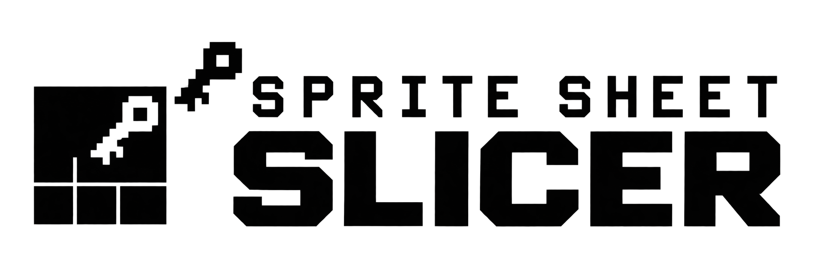
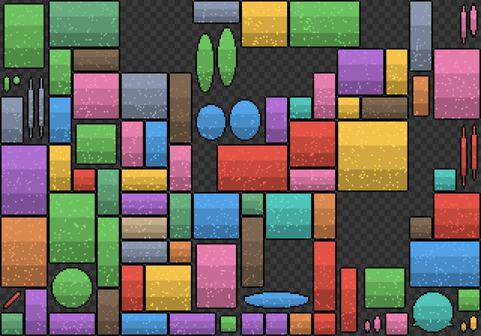
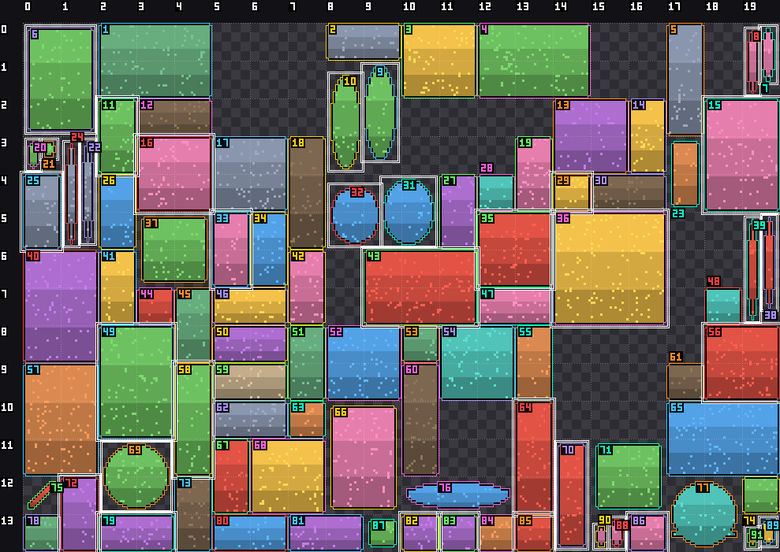
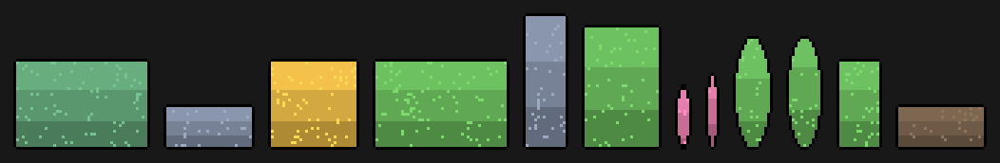

<p align="center">
  
</p>

# sprite-sheet-slicer

An agent skill for Claude Code and Codex that cuts a pixel-art sprite sheet into one PNG per asset and writes a catalogue of what it cut. It works as a sprite sheet splitter or unpacker for sheets that were never packed by a tool: it extracts the sprites from a sheet, tileset or icon sheet and writes a texture atlas description alongside them.

| The sheet | The review page Claude reads |
|---|---|
|  |  |



The sheet above comes from the test generator in this repository. Its 30 connected blobs were cut into 91 objects along the seams where two outlines meet.

It is meant for the sheets a grid import gets wrong: props packed edge to edge, assets drawn as several loose pieces, enlarged store previews, sheets with no grid at all. A script finds every object on the sheet and draws numbered review pages. Claude reads the pages, decides which objects make up one asset, and answers with short edit ops. The script checks the ops, applies them and exports the sprites.

The idea behind it is a split of work. The script owns the pixels: it knows exactly which pixel belongs to which object. Claude owns the meaning: whether three blobs are three tool carts or one long shelf. They talk in object ids and ruler positions printed on the review pages, never in pixel coordinates read off a picture, because a vision model's coordinates are approximate. The one free position the script accepts (`cut` with `px` on a sheet without a grid) is moved to the strongest seam within 3 pixels.

## Requirements

- Node on PATH (developed on Node 24). There is nothing to install; the scripts use only Node's standard library, PNG codec included.
- Claude Code or Codex.
- PNG input. Interlaced and animated PNGs are refused with a message.

## Installation

As a plugin, from inside Claude Code:

```
/plugin marketplace add GabrielKimm/sprite-sheet-slicer
/plugin install sprite-sheet-slicer@gabrielkimm
```

The skill is then available as `/sprite-sheet-slicer:sprite-sheet-slicer`. From a shell the same two steps are `claude plugin marketplace add GabrielKimm/sprite-sheet-slicer` and `claude plugin install sprite-sheet-slicer@gabrielkimm`.

Or as a plain skill, by copying the folder:

```
git clone https://github.com/GabrielKimm/sprite-sheet-slicer
cp -r sprite-sheet-slicer/skills/sprite-sheet-slicer ~/.claude/skills/
```

Use a project's `.claude/skills/` instead to keep it with that project.

In Codex, ask for it by URL (`Install the skill at https://github.com/GabrielKimm/sprite-sheet-slicer/tree/main/skills/sprite-sheet-slicer`), or copy the folder yourself and restart Codex:

```
git clone https://github.com/GabrielKimm/sprite-sheet-slicer
cp -r sprite-sheet-slicer/skills/sprite-sheet-slicer ~/.codex/skills/
```

It can then be called as `$sprite-sheet-slicer`. In every case, requests such as "slice this sprite sheet" or "split this asset pack into sprites" trigger it.

The skill does not declare `allowed-tools`, so Claude Code may ask for permission before each `node` command until you allow it. Codex follows its own approval mode.

## How it runs

You normally do not type these commands; the agent runs them while following `SKILL.md`. They are shown here so you know what happens, and they work the same by hand. `node skills/sprite-sheet-slicer/scripts/sheet.js --help` lists every option.

The example uses a synthetic icon sheet from the test generator, run from the repository root:

```
node test/gen.js demo 71
node skills/sprite-sheet-slicer/scripts/sheet.js detect demo/icons_71/sheet.png --work work --tile 16
```

`detect` reports the background, the tile size and the number of objects (140 here, because many icons are drawn in two pieces). `--tile` comes from the pack description; it matters most on art without outlines, where leaving it out costs about 50 points (see docs/EVALUATION.md).

```
node skills/sprite-sheet-slicer/scripts/sheet.js review --work work
```

`review` writes `work/pages/*.png`, where every object has a coloured contour and an id, with a ruler of cell numbers along the edges, plus `work/objects.json` and printed hints about objects that share a cell or sit close together with the same colours. Claude reads the pages and writes an ops file. On this sheet one `cells` op joins the pieces that share a grid cell, and a `drop` removes category label boxes:

```json
{ "rev": 0, "ops": [
  { "op": "cells" },
  { "op": "drop", "ids": [1, 3, 41], "reason": "category label boxes" }
] }
```

Save that JSON as `work/ops_r1.json` (any editor works; avoid PowerShell's `>` redirection, which can write UTF-16).

```
node skills/sprite-sheet-slicer/scripts/sheet.js apply --work work --ops work/ops_r1.json
node skills/sprite-sheet-slicer/scripts/sheet.js review --work work
node skills/sprite-sheet-slicer/scripts/sheet.js export --work work --out out --pad cell
```

`apply` is all or nothing: the file names the revision it was written against, and if any op is rejected nothing changes. After each apply Claude reviews again; one to three rounds is normal. An optional `--names` file on `export` gives assets names, categories and tags; without it they get generated names like `obj_0042`.

The output folder then holds:

| File | Contents |
|---|---|
| `sprites/<name>.png` | One image per asset, holding only that asset's pixels |
| `sheet.png` | The sheet at native size, background transparent, dropped objects removed |
| `atlas.json` | TexturePacker JSON hash over `sheet.png` (loads in Phaser and PixiJS) |
| `assets.json` | The catalogue: name, category, rectangles, size in tiles, cell origin, pivot, shadow |
| `ASSETS.md` | The same catalogue as a table |
| `contact_NN.png` | The sheet with every asset outlined and numbered, for finding a sprite by eye |

Export ends with a coverage check: each sprite is read back from disk and pasted where it came from. `"complete": true` means no artwork pixel was lost or duplicated. It does not mean the sheet was divided at the right places; only the review covers that. Field reference: `skills/sprite-sheet-slicer/references/outputs.md`.

## What it handles, and where it is the wrong tool

It was built for hard-edged pixel art: furniture and prop sheets packed edge to edge, loose props with gaps, icon grids with label boxes, terrain tilesets, sheets with no lattice, enlarged previews on a flat or checkerboard background, sheets with semi-transparent shadows. `skills/sprite-sheet-slicer/references/sheet-kinds.md` describes each kind.

Use something else in these cases:

- A grid with one icon per cell, or a pure tileset. Your engine's grid import already gets these exactly right. The skill gets there too, but it costs one extra op and a review round.
- Anti-aliased or painted artwork, high-resolution illustration, JPEG. Out of scope; segmentation will be poor.
- Composed scenes, where objects overlap and stand on a floor. These cannot be cut into clean assets; `detect` says so.
- Two assets drawn overlapping inside one outline. They cannot be separated.
- A background the same colour as the outlines. The script warns; ask for a transparent source.

Shadows are given to the object above them. Where neighbours' shadows run together the split is approximate: on dense synthetic sheets 88 to 93% of shadow pixels went to the right owner. Animation frames come out as separate sprites; nothing groups them.

## Measured results

From a held-out set of 40 synthetic sheets (3,219 assets) that the script first saw after development had finished. Exact means one object owns exactly the asset's pixels and nothing else. The mean counts each of the 10 sheet families once.

| Method | Exact, family mean |
|---|---|
| Script alone, tile size given | 86.2% |
| Script alone, no tile size | 75.8% |
| Plain connected components (an editor's auto-slice) | 49.0% |
| Grid import, one sprite per occupied cell (8 families with a grid) | 43.4% |

On 7 of these sheets (585 assets), Claude running the full skill got 95.6% of assets exact, pooled over the assets, where the script alone got 82.2% on the same sheets.

These sheets come from this repository's own generator, which draws cleaner art than commercial packs, so the figures are not a claim about commercial sheets. The script alone gets 98.7% of single-piece assets and almost none of the assets drawn in several pieces; joining those is the review loop's job. Method, per-family baselines and open problems are in [docs/EVALUATION.md](docs/EVALUATION.md).

## Artwork licences

You are responsible for having the right to process the artwork you slice. Some asset packs forbid feeding their images to AI. The skill reads the licence text when you give it a store page or readme, and if the licence restricts AI use it stops and asks you how to proceed. If you want the artwork kept away from the model, it runs the scripts and leaves the review pages and the ops file to you.

## Development

```
npm test
npm run bench
```

`npm test` runs 40 behaviour tests of the commands and edit ops on small hand-built sheets. `npm run bench` generates the development set into `.bench/cases`, runs `detect` on each sheet and scores it against ground truth. To reproduce the held-out table above:

```
node test/gen.js .bench/heldout 71,72,73,74
node test/bench.js .bench/heldout .bench/runs --mode hint
```

`--mode auto`, `nosplit` and `gridcell` give the other rows.

```
skills/sprite-sheet-slicer/
  SKILL.md            workflow and decision rules Claude follows
  references/         ops reference, sheet kinds, output fields
  agents/openai.yaml  name and prompt shown in the Codex skill list
  scripts/
    png.js            PNG decoder and encoder on node:zlib
    core.js           scale, background, components, lattice, seams, shadows
    draw.js           review page rendering
    sheet.js          the CLI: detect, review, apply, export, status
test/
  gen.js              synthetic sheet generator with exact ground truth
  score.js            scores a work folder against ground truth
  bench.js            script-only benchmark and the two baselines
  behaviour.js        behaviour tests
docs/
  DESIGN.md           design decisions and algorithms
  EVALUATION.md       method, results and limits
```

## Licence

MIT. See [LICENSE](LICENSE).
